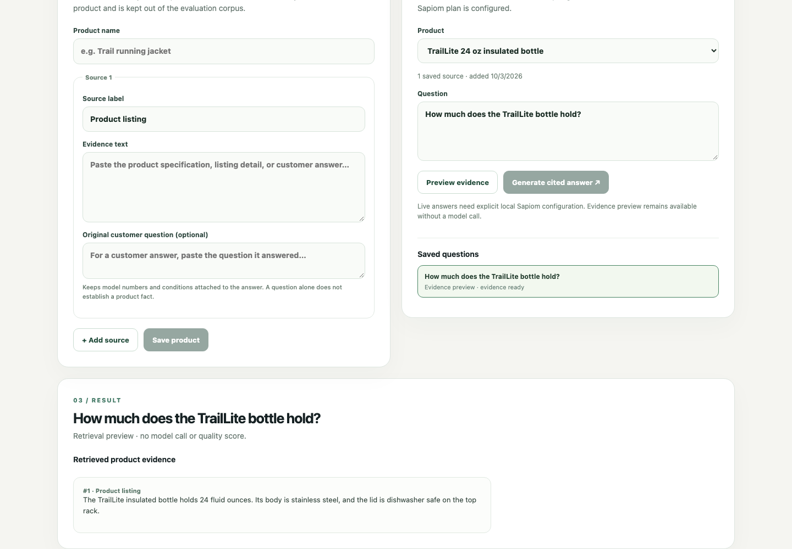
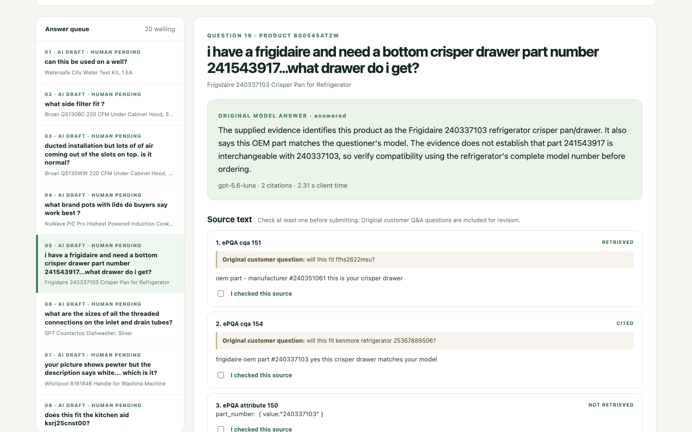
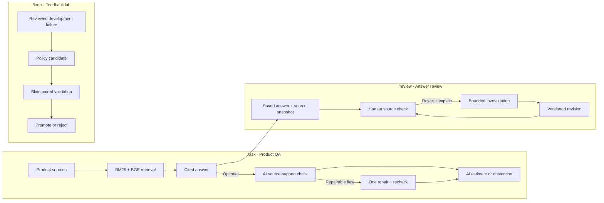

# Ablatrix

**Product QA with scoped retrieval, cited answers and a bounded correction harness.**

Ablatrix is a local product QA prototype. It retrieves product-specific passages, generates cited answers through Sapiom when explicitly enabled, and saves source snapshots and revision receipts. Optional automatic source checks can request one repair, then pass an AI check or abstain. Regression contracts check retrieval and execution reliability in CI; a separate feedback lab tests answer-policy changes against fresh products before promotion.

## See it

**Product QA —** a synthetic bottle question and its retrieved source. This preview makes no model call.



**Answer review —** a saved paid answer beside its original customer-question context and source text. This example is awaiting human review.



## How it works



Every completed `/ask` answer enters `/review`. One local worker saves jobs, source decisions, and immutable answer versions in SQLite. It can use saved evidence or, with a separate opt-in, search approved hosts once and read at most two pages before requesting one revised answer. Search snippets are leads, not citations. The historical 20-answer evaluation remains at `/paid-review`; workspace decisions never enter its results. The lab keeps development, validation, and final products separate; synthetic demo scores never count as model improvement.

## Reproduce one workflow

Requires Node.js **24.10+**. The first preparation downloads pinned public embedding weights.

```sh
npm ci
npm run feedback:prepare
npm run local
```

Open [Feedback lab](http://127.0.0.1:4173/loop), choose **Synthetic demo**, then select **Canvas Panel 8X10 Pack of 12** and its development question **“how many are included?”**. Get an answer: the deterministic baseline abstains. Open the retrieved passage, mark the abstention as unnecessary, and save a review explaining that the supported package count should be stated directly, with that passage selected. In **Propose an update**, select the reviewed failure and inspect the candidate policy. Run **paired validation** on held-back questions, then inspect the saved decision and policy history. This is a deterministic workflow demonstration: its answers and validation verdicts are synthetic, so they establish no model-quality gain.

For your own products, open [Product QA](http://127.0.0.1:4173/ask), save source text, and preview retrieval. A completed answer links to [Answer review](http://127.0.0.1:4173/review): explain a flaw, continue reviewing another answer, then return to compare and source-check the revision. Live Router answers require explicit local opt-in, a server-side credential, and a shared planning allowance. Optional source discovery has a separate opt-in. The allowance is **not** a provider-enforced spending cap or a settled bill.

To reproduce that answer-to-review workflow without paid calls, run `node --import tsx --test server/workspace-review-api.test.ts`. It exercises the HTTP API and real background worker with an injected synthetic transport, including duplicate rejection requests, stale decisions, and restart recovery. See [workflow and limits](docs/workspace-answer-review.md).

### Automatic reliability gate

For new `/ask` answers, **Automatically check sources and repair once** starts a background check against the frozen source packet. Every server-defined answer unit must be assessed; literal citations and known source IDs are checked separately. A definite repairable flaw permits one revision and an independent recheck. Missing support, uncertainty or an unverified receipt stops the sequence. Original answers remain accessible, and no human acceptance is recorded. This is an **uncalibrated AI estimate**, not measured correctness. The live option is disabled by default and needs a separate approved plan for up to three extra calls per answer. See [workflow, offline example and limits](docs/automatic-source-checks.md).

```sh
npm run check:reliability -- --out /tmp/ablatrix-reliability.json
```

This offline command checks adversarial source retrieval and the revision worker, including crowded model scopes, rejected citations, restart recovery and zero-dispatch stops. CI runs it and uploads a report with expected and observed values for each checkpoint. It needs no manual judgments or paid calls. The default embeddings and provider responses are synthetic; a separate cached BGE mode exercises the real local embedding runtime. See [contracts, results and limits](docs/automated-reliability.md). Passing these contracts establishes regression coverage, not arbitrary answer correctness.

The [sealed v3 qualification benchmark](docs/grader-qualification.md) prepares 80 fresh constructed packets and 12 separate consistency checks with frozen requests, references and thresholds. Its offline rehearsal is scripted, its qualification record remains pending, and it provides no live dispatch or activation capability.

### Compare saved answers

For a focused local correction demonstration, follow the [five-case walkthrough](docs/local-correction-walkthrough.md): a supported control, clearer wording, a missed source, a saved wrong-context correction, and a missing-information stop. `npm run walkthrough -- --out /tmp/ablatrix-walkthrough.json` freezes its inputs and checks source-routing without paid calls. The [two-call live follow-through](docs/evidence/local-correction-live-2026-10-10.md) produced mixed results: clearer color wording, but excessive abstention despite a stronger capacity source. Human decisions remain pending.

Open [Compare answers](http://127.0.0.1:4173/compare) and load the **synthetic example**. Review anonymous A/B answers against their complete source context, record correctness, support, and adequacy, then inspect the report and export. The example makes no model calls; its reviews and results stay labeled synthetic. Missing judgments remain pending, and uncertain judgments remain unresolved.

The workbench also imports experiment packets through `npm run compare -- import --db .data/context-comparisons.sqlite --packet /absolute/path/packet.json`. Separate formats compare original-question metadata or revision policies. The latter holds the original answer, critique and sources constant while changing the revision instructions. A saved packet protects review integrity; it does not prove that an experiment was planned before generation or authenticate provider records. See the [comparison protocol](docs/context-comparison-protocol.md) and [packet format](docs/context-comparison-contract.md).

The [server-resolved citation comparison](docs/evidence/source-id-correction-2026-10-10/live-report.md) stopped after eight of 24 planned calls: seven accepted outputs with 22 exact source-body citations, then a rejected malformed citation ID. Two of eight revision pairs completed; the remaining calls were not attempted. No human quality result or measured improvement was established.

The subsequent [citation-schema fix](docs/constrained-source-ids.md) declares only the IDs offered in each request. The [six-call diagnostic](docs/evidence/source-id-diagnostic-2026-10-11/live-report.md) stopped after five attempts: four accepted outputs with 12 exact source-body citations, then a citation-container shape error; one revision stayed unattempted. Declaring the schema did not prevent that invalid shape. Router-enforced decoding and answer-quality improvement remain unverified. The additive [flat-ID interface](docs/flat-source-ids.md) reproduces that failure with synthetic responses and preserves the earlier contracts. It is qualified offline. The unexecuted [fresh quality comparison](docs/flat-source-quality-comparison.md) preserves its audited source snapshots; its frozen execution plan needs new qualification after the retrieval change.

## Private demo package

The [restricted hosted demo](docs/hosted-demo.md) packages `/ask` → `/review` → correction → export with verified gateway identity, viewer/reviewer/operator roles, one persistent SQLite volume, and offline backup/restore. Synthetic templates let invited users rehearse the workflow without paid calls. Hosting, HTTPS identity configuration, and an external deployment are still pending; this is not a public live service.

## Saved results

| Experiment | Verified observation | What it establishes |
| --- | --- | --- |
| [Completeness/confidence grader v3](docs/evidence/grader-coverage-confidence-2026-10-15/live-results.md) | **6/6 live grading calls** returned valid grades matching every frozen axis; **0/3** flawed answers received a raw pass. | The guided development smoke passed on six fresh constructed cases with AI-authored references. General calibration, answer-quality gain and live policy activation remain unqualified. |
| [Abstention-aware grader v2](docs/evidence/grader-abstention-2026-10-14/live-results.md) | **5/5 live calls** returned valid grades. The justified refusal correctly abstained; all five routing decisions matched frozen sets. Only **3/5** cases matched every grading axis. | The targeted proof-contract regression worked on one new constructed example. The full smoke gate failed on completeness and uncertainty labels; v2 remains a candidate and no general quality gain is established. |
| [Live grader pilot](docs/evidence/grader-calibration-2026-10-14/live-results.md) | **5/10 planned calls** executed: **4 valid grades**, **1 invalid output**, **5 unattempted**. Two good answers passed; two flawed answers were flagged for repair or left uncertain. **2/4** valid grades matched every frozen reference axis. | A partial discrimination check on constructed fictional examples with AI-authored references. The invalid abstention grade stopped execution; general calibration, live activation and answer-quality gain remain unproven. |
| [Pinned product QA batch](docs/evidence/paid-qa-batch-2026-09-28/report.md) | **20/20** one-attempt live Router calls completed on 20 distinct products; **52/52** returned citation quotes occur verbatim in their saved retrieved passages. [Inputs](docs/evidence/paid-qa-batch-2026-09-28/manifest.json) and [outputs](docs/evidence/paid-qa-batch-2026-09-28/results.json) are saved. | Call completion and mechanical quote provenance on curated evidence, **not** answer correctness or citation relevance. |
| [Correction walkthrough](docs/evidence/local-correction-live-2026-10-10.md) | **2/2** real revision calls completed; **5/5** quotes matched. AI review found clearer wording in one case and better source use with excessive abstention in the other. | The correction workflow runs end to end. These selected development cases are not a quality-gain benchmark; human review is pending. |
| [Correction-policy round](docs/evidence/correction-policy-2026-10-10/report.md) | Six development calls passed the AI gate, with **18/18** exact quotes. Fresh execution stopped after **4/24 planned attempts**: three accepted outputs, one rejected non-verbatim citation, **20 not attempted**. | One of eight planned pairs completed; no fresh human judgments or quality gain. The rejected response and full planned denominator are retained. |
| [Citation delivery diagnostic](docs/evidence/source-id-diagnostic-2026-10-11/live-report.md) | **5/6 planned attempts**, **4 accepted outputs**, **12/12** full-source citation matches; **2/3** targets observed. The fifth response returned valid IDs as strings instead of required objects and was rejected; one revision was unattempted. | An incomplete check on three exposed contexts. Known-ID delivery worked in accepted outputs; response-shape reliability and human-reviewed quality remain unresolved. |
| [Live search ablation](docs/pilot-live-results-2026-09-24.md) | **16 matched pairs / 32 answers** across eight GitHub Actions questions; omitting an extra web search cut the **median paired answer-stage time by 81.2%** and **meter-derived aggregate cost by about 96.2%**. [Per-call measurements](docs/evidence/search-ablation-2026-09-24.csv) are public. | A narrow source-given search decision. Timing starts before optional search and ends after the Router answer; shared source collection is excluded. Cost uses 16 searches × $0.006 plus published Router token rates: $0.100216 search-on versus $0.003858 search-off. It is not a settled per-call bill. |

**Quality status:** Exact quote membership is distinct from whether a quote supports a claim, whether an answer is correct, and whether users prefer it. The product batch has 20 historical human judgments, but they predate restoration of the original customer-question context and are excluded by the current review protocol; **0/20 context-aware human judgments** are saved. The ablation's independent blind human correctness review is also pending. These experiments do not prove an answer-quality improvement; no policy was promoted on these results.

For implementation details, see [architecture](docs/architecture.md), [feedback-loop setup](docs/feedback-loop-local.md), [investigation limits](docs/revision-investigation.md), [corpus provenance and license](docs/product-corpus.md), the [remaining release plan](docs/next-release-plan.md), and the [build and evidence ledger](docs/build-plan.md). The earlier [search ablation](docs/search-ablation.md) and [research agent](docs/sapiom-accounting.md) are documented separately.
