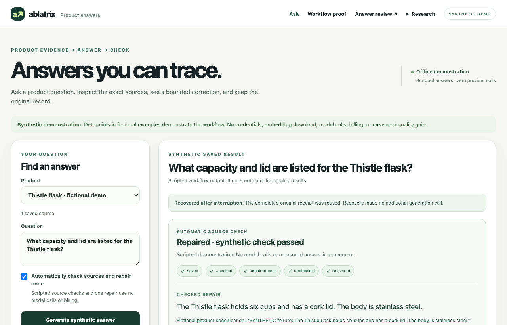
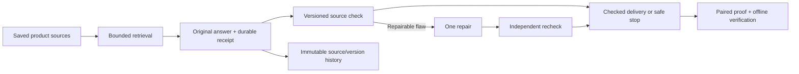

# Ablatrix

**Product answers with an inspectable correction trail.**

Ablatrix answers a product question from saved sources, checks the claims, attempts one bounded repair, and either delivers a checked response or stops. The original answer, exact source packet, request identities and versioned decisions remain inspectable. Proposed instruction changes are a separate evaluated workflow; live policy release remains closed.



## Try it in five minutes

Requires **Node.js 24.10+**. No credential, paid call or embedding download is needed for the isolated demonstration.

```sh
npm ci
npm run demo
```

Open [the local demo](http://127.0.0.1:4184). Each launch creates fresh SQLite files under `work/demo/session-*`; it does not adopt an existing live or hosted database. The command does not load `.env`. Its server binds to loopback. An existing product server on port 4194 is unaffected.

1. Inspect the preseeded Thistle flask answer. It was recovered from its completed original receipt after an injected interruption, with no second generation.
2. Open **Original answer**, **Why this result?**, and **Inspect exact saved sources**. The original says eight cups; its saved specification says six. The scripted check permits at most one repair and an independent recheck.
3. Select the Aster box question to inspect an uncertain-check safe stop. The unsupported original remains available as a saved version.
4. Ask the Thistle flask question with automatic checking enabled, then inspect the final delivery. A browser retry reuses its request identity after a lost response.
5. Open **Workflow proof**, switch between paired outcomes and quality/time/allowance, and export exact evidence. The denominator includes unresolved requests.
6. Expand **Answer policy** to inspect a separately evaluated blanket-abstention candidate: its actual 13-phase synthetic trial is rejected and the baseline remains active.

Everything in this journey is visibly **synthetic**. Scripted outcome labels verify engineering behavior; they are not model-quality measurements or human judgments. The read-only live replay below the proof view is separately labeled and never executes a new call.

[Walkthrough and artifact guide](docs/product-workflow-demo.md) · [Current results and limitations](docs/current-results.md)

## What is measured today?

The latest recorded live v3 qualification **failed after 20/92 planned calls**: 19/20 critical-axis matches, 18/20 full-axis matches, 0/15 flawed answers receiving a raw pass and 5/5 acceptable answers routed correctly. No repeat checks ran; 72 calls were unattempted. These are constructed cases with AI-reviewed references, not a real-user quality rate. [Sanitized immutable result](docs/evidence/grader-qualification-live-approval-ux-2026-10-16/RESULTS.md).

The current release makes the actual flat-source generation and v4 check contracts explicit. **Fresh v4 live qualification, whole-workflow correction benefit and future-policy gain remain unmeasured.** Literal quote membership, cited semantic support, factual consistency, applicability and completeness are separate checks. Neither a passing script nor a qualified grader automatically releases an answer policy.

A separate first-answer comparison completed **16 live calls across eight products**. Two blind AI source reviews agreed on one substantive candidate preference and six ties, with one disputed benefit; both preferred the candidate's wording on six of eight. All 39 citation occurrences matched offered text, which is a separate mechanical check. Saved human source-checked judgments remain 0/16; the candidate is experimental. [Answers, disagreements and reproducible results](docs/evidence/answer-quality-source-calibration-2026-10-18/RESULTS.md).

The latest additive retrieval candidate delivers **12/13 designated source units versus baseline 10/13** on twelve exposed development products, preserving baseline context in every case. No new answers or answer-quality gain are measured. The original failed v2 test remains preserved. [Review, full results and offline replay](docs/retrieval-diagnosis-parent-review-2026-10-19.md).

## The product path



`/` and `/ask` open the product workspace. `/review` exposes original versions, source-aware feedback and bounded background revision. `/research` retains the older research UI; `/loop`, `/compare`, `/pilot` and `/paid-review` remain secondary research tools. The isolated demo blocks legacy experiment dispatch and does not load pinned evaluation answers.

SQLite is the current single-process storage boundary. Requests capture policy instructions before retrieval. Completed receipts can recover a saved original after interruption; unknown outcomes are retained and never silently redispatched. Checks freeze the grader contract and qualification scope. Authenticated hosted mode preserves viewer/reviewer/operator roles; the local demo is a separate loopback-only operating mode.

## Verify without paid calls

```sh
npm test
npm run build
npm run check:reliability -- --out /tmp/ablatrix-reliability.json
npm run test:e2e
npm run proof:development -- --out /tmp/new-development-proof.json
npm run proof:verify -- --verify /absolute/path/to/downloaded-proof.json
npm run proof:verify -- --proposal
```

The reliability harness uses injected embeddings and scripted transports. It checks retrieval, exact sources, receipt recovery, duplicate requests, late responses and zero-dispatch stops. This establishes regression coverage, not arbitrary semantic correctness. The development proof compares critique-guided repair with a matched extra-call rewrite on exposed synthetic cases; a scripted tie does not establish feedback benefit. Downloaded demo exports retain source, version, receipt, accounting and provenance identities; see [proof verification](docs/product-workflow-demo.md) and the [frozen evidence protocol](docs/proof-protocol.md). The proposal command performs no live execution.

## Use your own sources

The normal local workspace uses hybrid BM25 + pinned BGE retrieval. Its separate preparation may download embedding weights:

```sh
npm run feedback:prepare
npm run local
```

Open [Product QA](http://127.0.0.1:4173/ask), add source text you have permission to use, and preview retrieval. Live Router generation requires explicit authorization, server-side configuration and a bounded shared planning allowance. The new v4 live automatic-check scope remains closed pending qualification. External discovery has an independent opt-in and approved-host scope. Planning allowances are not settled provider charges or a provider-enforced cap. Building this release authorizes no paid execution or deployment.

## Documentation

- [Architecture and operating boundaries](docs/architecture.md)
- [Current results](docs/current-results.md) and [full evidence chronology](docs/build-plan.md)
- [Six-slice release plan](docs/next-release-plan.md)
- [Source-aware review and revision](docs/workspace-answer-review.md)
- [Automatic source checks](docs/automatic-source-checks.md)
- [Restricted hosted mode](docs/hosted-demo.md) and [backup/restore](docs/hosted-demo.md)
- [Corpus provenance](docs/product-corpus.md), [legacy research accounting](docs/sapiom-accounting.md), and [historical search ablation](docs/search-ablation.md)

There is no fresh human-reviewed answer-quality gain or released learned policy in this release. Historical experiments, unsuccessful attempts and human events remain preserved.
