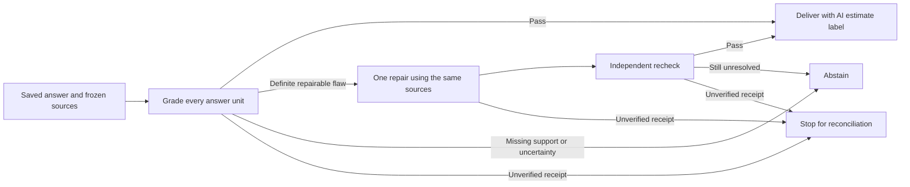

# Automatic source checks

New `/ask` answers can enter a background source-support check. A reviewer can keep working while the queue checks the saved answer, requests at most one repair, and independently checks that repair. The final result selects a checked answer or abstains; the original remains saved.



## What the check means

| Axis | Enforcement | Limit |
| --- | --- | --- |
| Citation membership | Server checks known source IDs and literal body quotes. | Matching text does not establish relevance or truth. |
| Answer-unit coverage | Server provides verbatim units covering the complete answer; every unit must appear once in the result. | A judge can still miss an assertion inside a unit. |
| Claim support | Judge considers product/model context, attribution, contradictions and cited proof. | Uncalibrated AI estimate; source labels are not independently verified authority. |
| Source-only consistency and completeness | Separate judge fields assess consistency with the packet, requested details and uncertainty. | These do not establish external truth or human-reviewed quality. |
| Execution | Durable phase IDs, exact request bindings and consumed allowances prevent automatic retry of uncertain calls. | Local planning allowances are not settled charges or a remote hard cap. |

Customer Q&A parent questions and customer clarifications provide context. Proof quotes must come from source bodies. The judge receives the full answer and frozen source packet, and its repair assessment excludes the earlier grade and critique. Every assessment is labeled `ai_claim_support_estimate` or `synthetic_scripted_claim_support`, with `calibration: not_measured` and `qualityClaimEligible: false`.

## Reproduce without paid calls

```sh
npm ci
node --import tsx --test server/claim-support.test.ts server/automatic-support.test.ts server/automatic-support-api.test.ts
```

The HTTP example creates a fictional bottle with the source `SYNTHETIC fixture: This bottle holds 600 ml and has a twist cap.` It submits a new synthetic question with `automaticCheck: true`. The real background worker processes original grade → one repair → repair grade using durable scripted receipts. The assertions inspect the selected revision, unchanged original and zero human decision events. These fixtures test contracts and workflow mechanics; they do not calibrate a live judge or demonstrate model improvement.

In `/ask`, select **Automatically check sources and repair once** before generating a new answer. `/ask` and `/review` show the background status, final AI estimate and original answer. Unflagged historical answers and GET requests never enqueue checks. Intent is saved before generation; startup can recover a completed answer's pending handoff without generating it again. A failed handoff preserves the generated answer, receipt and unavailable status across reloads. Workspace export includes the automatic records separately from human reviews.

## Bounds and restart behavior

- At most **three additional model calls**: one original grade, one repair and one repair grade. A passing original needs one extra call.
- Each phase has a distinct durable operation ID and runs under a separate lease. Completed receipts are revalidated against the exact request before replay.
- Uncertain, malformed or mismatched receipts stop the sequence. A started operation without a receipt is never dispatched again.
- Both workers share provider exclusion and the existing planning ledger. Capacity is checked for the full remaining sequence before dispatch.
- Full source context is preflighted before generation with ordinary answer headroom; actual serialized outputs are checked again before grading. Sources remain frozen. This slice performs no search, page reads or retrieval expansion.
- Automatic records stay in their own SQLite table. They never create human acceptance events, increment human quality scores or promote an answer policy.

## Live status

Live automatic checking is **disabled by default and unexecuted**. It requires a separately approved bounded plan, `ABLATRIX_AUTOMATIC_CHECK_LIVE=1`, the existing Router opt-in and credential, and sufficient shared planning allowance. The HTTP endpoint checks capacity for the original answer plus three possible extra calls before generation. Building this feature does not authorize those calls. The production deployed-agent gates remain unchanged.

Offline verification: **346 server tests passed** with one Linux-only skip; build and **14 focused browser checks** passed, including six automatic-check scenarios. All 107 protected experiment-file hashes are unchanged; the live ledger remains at 86 attempts, zero pending reservations and zero new paid calls. The current result is an offline implementation and regression check. Judge calibration, live behavior and any answer-quality gain remain unmeasured. Routine product progression no longer requires a human decision; historical human reviews and final benchmark/promotion requirements remain separately recorded.

Model judges need calibration and should be combined with objective execution checks; this design uses strict source and receipt contracts around a labeled AI assessment. See Anthropic's [agent evaluation guidance](https://www.anthropic.com/engineering/demystifying-evals-for-ai-agents).
