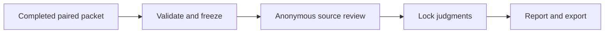

# Next release plan

Updated October 17, 2026 following a source-code, saved-results and research audit. The [build and evidence ledger](build-plan.md) retains implementation history. The numbered slices below are proposed work, not existing GitHub PR numbers or completed capabilities.

**Product direction:** an inspectable product-QA workflow that retrieves applicable sources, detects unsupported answers, attempts one bounded correction, and evaluates proposed instruction changes before releasing them to future questions.

**Current priority:** recover completed answers after interruption, connect the intended citation and grader contracts to the actual workspace path, and measure whether correction helps. External hosting remains deferred. A useful local demonstration and reproducible evidence are the release target.

## Initial October 17 audit, before the six-slice build

These observations describe the pre-build state. The October 17 implementation status below records the completed engineering changes; [current results](current-results.md) remains the release-status index.

- The current offline reliability command passed 11 retrieval scenarios and four revision-harness scenarios using injected embeddings and scripted responses. This establishes mechanical contracts; semantic assessment was not run.
- The latest v3 qualification stopped after 20 valid live grades: 19/20 critical-axis matches, 18/20 full-axis matches, zero raw passes among 15 flawed answers evaluated, five of five acceptable answers routed as expected, 72 planned calls unattempted and no repeat observations. Qualification failed; live activation remains closed. These are constructed cases with AI-reviewed references, not a real-user quality rate. The sanitized current result still needs to be incorporated into the public evidence index.
- Isolated synthetic reproductions confirmed a first-answer receipt-to-workspace recovery gap and a difference between activated-policy inspection and actual question capture. A third late-response regression requires overlapping automatic-check workers; it is hardening for overlapping recovery, not an ordinary singleton failure.
- `/ask` still uses the legacy snippet/copy citation choice, and automatic checks implicitly select grader v1. The newer flat-source interface and v3 qualification do not change these runtime defaults.
- Current natural-product retrieval coverage and whole-workflow repair benefit remain unmeasured under the latest implementation. The September retrieval audit and selected correction examples remain historical development evidence.

## Six bounded build slices

### 1. Recover completed work and prevent duplicate requests

Persist the original question request identity and add request idempotency. Reconcile a matching completed provider receipt when the process stops before the workspace answer is saved, then resume its requested review/check handoff. Preserve uncertain outcomes without dispatching again. Add persisted phase and terminal-state checks before consuming a late automatic-check response.

**Acceptance:** injected crashes before reservation, after reservation, after receipt persistence and after answer persistence produce explicit, correct states. A restart recovers one completed answer with zero additional dispatches. A repeated request returns the same run. An overlapping recovery cannot reopen a terminal job. Extend the existing harness report with these scenarios.

### 2. Qualify the actual RAG and citation path

Exercise the existing flat-source citation resolver through the workspace request path with a versioned generation contract. Cover decimals, complete source bodies, original customer questions, wrong-context IDs, duplicate IDs and malformed response shapes. Replay the current retriever over already exposed development questions and source-sufficiency cases. Classify omitted facts, missing source information, conflicts and generation misuse separately.

First reproduce whether the approximately 300-byte workspace chunks separate a claim from its condition. Change chunk boundaries or add bounded neighboring context only when that test demonstrates loss. Evaluate retrieval changes against the same frozen development inputs before choosing a candidate.

**Acceptance:** workspace generation uses the intended protocol, invalid citations fail explicitly, and exact saved sources remain reconstructable. Publish current code/model/data identities and required-fact/condition coverage. A targeted context-selection change must fix its reproduced failure without dropping applicable conflicts or exceeding the context budget.

### 3. Clarify and qualify the grader's operating scope

Create a new versioned grading contract separating factual consistency, support from the actual cited span, product/variant applicability, question coverage and appropriate uncertainty. Keep the consumed v3 cases as development regressions. Test supported facts with irrelevant citations, explicitly wrong variants, genuinely ambiguous scope, mixed assertions, justified refusals and unnecessary refusal.

Qualification must cover the answer lengths the product will send. Either constrain the qualified scope explicitly or include multiple answer units, boundary-spanning assertions and response-size preflight. Track exposed cases, source packets and related product families across cohorts so renaming or regrouping them cannot establish freshness.

**Acceptance:** the semantics are unambiguous before new outcomes are observed; oversized requests fail before dispatch; omitted units never pass. A fresh, independently reviewed qualification plan freezes references, scope, stopping rules and budget before execution. A failed or incomplete run remains unqualified. Build/review and a proposed plan do not authorize paid execution.

### 4. Bind runtime checks and policy release to verified evidence

Freeze grader version, prompt/schema identity, model identity and applicable qualification evidence into each new check job. Replay old jobs using their recorded contract. Use one verification boundary for policy activation, inspection and future-question capture, with operator attribution for authenticated release and rollback actions.

**Acceptance:** pending, failed, altered or incompatible qualification records cannot enable a qualified runtime grader. Missing activation support blocks affected candidate generation. In-flight requests retain captured instructions; later requests use an explicitly released version; rollback restores its parent. Grader qualification alone never activates an answer policy. Fixtures can prove these mechanics while live release remains closed.

### 5. Demonstrate correction benefit and future-policy benefit separately

Build one evidence bundle with frozen inputs, applicable sources, exact versions, paired outcomes, invalid/unknown states, receipts and labeled accounting. Verify the bundle offline without dispatch or new reservations. Retain the original answers as the paired control. On development cases, compare a critique-guided repair with a matched extra-call rewrite without critique to test whether feedback adds value beyond another generation attempt.

Use distinct data roles: exposed development cases; fresh judge-qualification packets with deliberately acceptable and defective answers; and fresh product-family-disjoint questions with naturally generated baseline answers for the complete workflow. Holdout product documents remain available in the frozen retrieval index; their queries and reference labels stay outside tuning. A later policy proposal requires another fresh comparison of future answers, holding the model, retrieval and grader constant.

**Acceptance:** report useful supported answers, factual errors, cited support, available-fact coverage, unnecessary abstention, wins/regressions/unresolved outcomes and total calls/time/usage. Report the whole frozen cohort as well as the repair-triggered subset. Repeated trials do not become additional independent products. Choose sample size prospectively from the smallest useful gain, tolerated regressions, observed development variability and budget; a small demonstration must retain that label. Preserve the baseline when improvement is absent or inconclusive.

Automate routine deterministic validation and qualified source checks. Audit severe anomalies, recurring failure groups and a random sample of apparently successful answers, with additional coverage of difficult variants and long answers. A rejection-only queue cannot expose silent false approvals. AI-only reference agreement retains AI provenance. The current repository contribution rules reserve final answer-quality claims and answer-policy promotion for source-checked human reviews plus demonstrated gain on fresh, product-disjoint validation. This release-evidence requirement does not require a person to check every routine answer.

### 6. Make the product and proof easy to inspect

Make `/ask` the clear local entry point, group historical labs under a secondary research area, and show a direct answer with expandable sources and precise uncertainty. Provide an isolated preseeded synthetic demo requiring no credentials or embedding download, plus a separately labeled read-only replay of a historical live case. Reuse current answer, review and export surfaces.

Record a 60–90-second walkthrough: original answer, precise flaw, bounded correction or justified stop, source inspection, then an export. Show a failure/recovery example and an evaluation that rejects a candidate. Synthetic behavior, recorded live output and fresh execution must remain visually distinct.

Refresh the README, architecture, screenshots and quick start around that journey. Scope the older architecture's statements about authorization, snapshots and its six-task suite to the legacy research path. Publish a concise sanitized current-results index with links to immutable underlying records; retain the full experiment chronology separately.

**Acceptance:** a fresh reviewer can complete the local demonstration in five minutes and inspect the code, source packet and verifier behind a result. Current status is consistent across the README, app and architecture. Use two result views: paired wins/ties/regressions/unresolved cases, and quality versus total time/planning allowance. Show observed outcomes with denominators and provenance. Include failed, rejected and uncertain attempts in recorded time, usage and reservations; missing measurements remain unknown. Do not infer an upward learning curve from unrelated or incomplete experiments.

## October 17 implementation status

The workflow branch implements all six engineering slices: durable first-answer reconciliation and idempotency; the actual versioned flat-source generation path with reproduced qualifier restoration; a separately versioned v4 grader; frozen runtime grader and policy-evidence bindings; paired proof export/offline verification and matched no-critique development control; and an isolated synthetic demo with current product navigation and historical replay.

Current checks remain mechanical or scripted. V4 live checking stays closed pending independent qualification. The consumed v3 execution plan rejects this changed implementation and cannot resume. Fresh qualification and product-family-disjoint workflow/future-policy packets still need independent source/family review, prospective code-bound plans, measured pilot assumptions, and separate paid-execution authorization. The proposed budget is a planning illustration, not an approved allowance. No fresh quality gain or policy release is claimed. See [proof protocol](proof-protocol.md) and [current results](current-results.md).

## Research informing the choices

- [ALCE](https://aclanthology.org/2023.emnlp-main.398/) evaluates correctness and citation quality separately; literal citation membership must not stand in for either.
- [RAGChecker](https://proceedings.neurips.cc/paper_files/paper/2024/hash/27245589131d17368cccdfa990cbf16e-Abstract.html) motivates diagnosing retrieval and generation independently before choosing a fix.
- [ARES](https://aclanthology.org/2024.naacl-long.20/) evaluates RAG with model judges and independently labeled examples; automated judgments need validation of their own.
- [Anthropic's agent-evaluation guide](https://www.anthropic.com/engineering/demystifying-evals-for-ai-agents) distinguishes harness behavior, outcomes and grader reliability, and recommends deterministic checks where possible with calibrated model grading.
- [Langfuse experiment comparison](https://langfuse.com/docs/evaluation/experiments/compare-experiments) already supports versioned comparisons and trace inspection. Ablatrix can use its existing optional export while concentrating product work on source-aware correction, recovery and release decisions.
- [Contextual retrieval](https://www.anthropic.com/engineering/contextual-retrieval) offers techniques worth testing when measured source coverage calls for them; its reported gains are not Ablatrix results or a reason to add every retrieval component.

Keep SQLite for the current single-process operating scope. Revisit storage and worker topology when measured concurrent usage or durability requirements demand it. Fine-tuning, additional agent frameworks and expanded hosting are separate decisions after the local workflow and its results are convincing.

## Earlier release-stage record (October 9)

The following stage account is retained as historical roadmap context. It is superseded by the priorities and acceptance criteria above.

| Stage | Intended result | Current position |
| --- | --- | --- |
| 1. Baseline and rubric | A saved answer, inspectable sources, and explicit quality judgments | Existing product QA, historical review packets, and feedback-lab rubrics provide the foundation. Context-aware human review remains pending. |
| 2. General product answers | New questions can enter the same review workflow | PR #22 connects completed `/ask` answers to `/review` through an immutable, recoverable source snapshot. |
| 3. Asynchronous correction | A reviewer explains a flaw, moves on, and returns to a versioned revision | PR #22 joins general answers to the existing bounded investigation/revision worker. Jobs, receipts, decisions, source provenance, and restart guards are preserved. |
| 4. Frozen quality comparison | Import a completed experiment, review anonymous pairs, and publish an honest report | Merged in [PR #23](https://github.com/jayeshsuyal/ablatrix/pull/23). A fresh live quality comparison remains a separate execution step. |
| 5. Restricted hosted demo | Another person can inspect and exercise a bounded, durable workflow | Package merged in [PR #24](https://github.com/jayeshsuyal/ablatrix/pull/24): verified gateway identity, roles, offline synthetic correction, persistent storage, and backup/restore. External deployment is deferred; see [operating guide](hosted-demo.md). |

PR #22 completes the shared engineering workflow across the first three stages, building on earlier implementations. Its merge does not establish a quality gain or complete the pending human judgments.

## Stage 4: comparison workbench

Build one complete path:

Use the [original-question context protocol](context-comparison-protocol.md). Its intervention changes only whether the model receives original customer-question metadata. Both arms retain the same current rules, policy, model configuration, retrieval, answer bodies, and quote options. Reviewers see the complete source context for both answers.

### Ship in this slice

- Completed-packet import with immutable identities, manifest checks, source provenance, matched-pair checks, and safe duplicate replay.
- Anonymous review cards with explicit correctness, support, and adequacy judgments tied to exact answer versions and source context.
- Clear pending counts and a locked report that separates supported, correct, adequate answers from unresolved judgments and mechanical citation checks.
- A synthetic rehearsal that covers import, review, report, export, and restart without provider calls.
- Tests for changed snapshots, hidden arm identity, incomplete or uncertain judgments, and separation from historical experiments and human quality claims.

Reuse the provider's existing execution and receipt mechanisms when a future experiment is approved. A new paid runner, model fine-tuning, more production dashboards, and a database migration are outside this slice's acceptance criteria.

### Keep the execution gate explicit

The workbench can be released with no fresh live packet and with human review still pending. Before executing a real comparison, freeze the plan and fresh cohort, audit product-family overlap, reserve its bounded calls, and obtain authorization for that concrete experiment. A completed-packet import freeze is not proof that the plan existed before generation. Imported live packets retain retrospective provenance with provider authenticity and pre-generation freeze unverified; internal consistency checks do not certify those claims.

Exclude the 56 historical ASINs across the curated, final, and paid corpora, plus subsequent workspace or experiment exposures. Preserve the two remaining legacy validation products and existing final corpus. The available pinned train pool permits a separate cohort, but no new benchmark is frozen or validated yet.

Use the existing 20 paid answers for development review and rubric calibration. Their **20 historical judgments and 0 current source-context-valid judgments** remain visible with their provenance. Saving new judgments does not turn those previously inspected products into fresh cases. The latest single `/ask` trial is also a development workflow observation, with its human decision separate from its AI source check.

**Stage 4 is done when:** the synthetic workflow passes its tests, production build, code review, and browser smoke check; packet invariants hold across reload/restart; the report preserves pending and inconclusive outcomes; and existing saved experiments and review records remain unchanged. Running more paid calls is unnecessary to meet this build gate.

## Stage 5: restricted hosted demo

Deploy a small demonstration with an explicit operating scope:

1. Authenticate invited users and enforce server-side access to products, runs, reviews, and experiment packets. Replace local reviewer-name attribution with authenticated identity for hosted writes.
2. Keep provider credentials on the server. Default public viewing to saved, redacted evidence and synthetic interaction. Gate any live generation by role, an explicit bounded allowance, concurrency limits, and the existing dispatch rules.
3. Give the single revision worker durable storage, restart recovery, bounded queue behavior, health checks, and inspectable failures. Test backup and restore of the workspace, review, and provider ledgers together.
4. Verify the complete deployed path: answer or fixture generation, review, queued correction, version comparison, restart recovery, and report export. Show the limits of the demonstration beside the result.

Choose database and hosting configuration from that operating scope. PostgreSQL becomes useful when the deployment needs concurrent application writers, shared worker access, or managed durability. A single-instance private demonstration can use SQLite with persistent storage and verified backups. Database choice does not replace queue correctness, access controls, or quality review.

**Stage 5 is done when:** an invited reviewer can complete the demonstrated workflow, unauthorized access and unbounded dispatch are blocked, a restart preserves jobs and receipts without duplicate calls, and the saved result is reachable through one stable public documentation link. Publishing or enabling paid access requires its own authorized release action.

## What the release may claim

Completed engineering can support: “Built a product QA workflow with hybrid retrieval, immutable source snapshots, asynchronous revision, and reproducible paired evaluation.”

Keep separate evidence for:

- Successful provider attempts and exact quote membership.
- Source applicability, answer correctness, and adequacy under the frozen rubric.
- Human review, AI-assisted assessment, and synthetic verification.
- A revision accepted on one answer and a measured effect across fresh paired cases.
- Local planning allowances, token estimates, and verified provider charges.

There is no new human-reviewed quality improvement claim at this stage. Preserve inconclusive and negative results alongside successful workflow tests. Once each slice meets its acceptance criteria, move to the next build stage; additional paid experiments should answer a frozen question rather than serve as a substitute for shipping the remaining product work.
